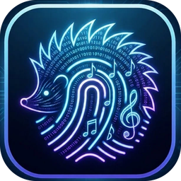

<h1 align="center">LDMHA</h1>

<b><a href="https://github.com/LabirintoDigitale/LDMHA/raw/apk/MusikHa.apk">⬇ Scarica l'app MusikHa (APK)</a></b> · <a href="https://github.com/LabirintoDigitale/LDMHA/releases">Versioni di LDMHA</a> · <a href="#installazione">Installa dal Marketplace</a>

Due strumenti per la musica di casa con **Home Assistant** e **Music Assistant**:

- **LDMHA**, integrazione per Home Assistant che **mette in ordine la libreria musicale**: riconosce i brani, corregge i tag, rinomina i file e toglie i doppioni.
- **[MusikHa](#musikha--lapp-per-android)**, app per Android: il lettore di Music Assistant a tutto schermo (APK in questo repository, si aggiorna da sola).

---

## LDMHA: la musica in ordine

Un pannello nella barra laterale di Home Assistant, **visibile solo agli amministratori** (rinomina e sposta file).

- **Riconosce i brani dall'audio**: impronta con [Chromaprint](https://acoustid.org/chromaprint) (`fpcalc`, scaricato da solo al primo uso) cercata su [AcoustID](https://acoustid.org), poi album, anno e numero di traccia da [MusicBrainz](https://musicbrainz.org). Funziona anche con file chiamati `traccia01.mp3` e senza tag.
- **Se l'impronta non trova niente** prova con **Shazam**, anche su più pezzi del brano (a 30 secondi, a metà, a tre quarti) se il primo non basta (libreria [ShazamIO](https://github.com/shazamio/ShazamIO), servizio non ufficiale, si installa da sola al primo uso; si può disattivare nelle opzioni), poi cerca su MusicBrainz per nome del file e tag; oppure a mano (*Cerca…*). Le proposte di Shazam valgono 85%: controllale prima di applicare.
- **Copertine**: nella scheda del brano vedi quella già nel file e quella proposta (dalla Cover Art Archive di MusicBrainz o da Shazam). Con *Applica* la copertina va nel file: solo se manca (predefinito), sempre, o mai. MP3, FLAC, M4A, OGG e Opus; annullando torna quella di prima.
- **Tag e nome nuovo**: scegli fra le proposte, correggi i campi se serve e premi *Applica*: scrive i tag (titolo, artista, album, artista dell'album, anno, numero, ID MusicBrainz) e rinomina il file con lo schema che vuoi, per esempio `{artist} - {title}` oppure `{artist}/{album}/{track} - {title}` (con le sottocartelle).
- **Tutti insieme**: *Riconosci tutti* passa la cartella (anche con le sottocartelle), *Applica i sicuri* sistema i brani riconosciuti dall'audio con sicurezza almeno del 90%.
- **Doppioni**: lo stesso brano in più file viene segnalato; *Cestino* lo sposta in `.ldmha_cestino` dentro la cartella della musica (niente viene cancellato).
- **Si può sempre tornare indietro**: ogni modifica (tag, nome, cestino) resta nella *Cronologia* e si annulla con un tocco.
- **Registro**: per ogni brano si vede cosa ha fatto (impronta, risposta di AcoustID con la sicurezza, ricerca su MusicBrainz, tempi); la scheda *Registro* raccoglie tutto.

### Fatto per librerie grandi

- **Albero delle cartelle** a sinistra, **tabella compatta** a destra che disegna solo le righe visibili: migliaia di brani restano fluidi.
- Colonne ordinabili, **ricerca** e **filtri** (da riconoscere, sicuri, incerti, doppioni, non trovati, sistemati, cestino).
- **Selezione multipla** (Maiusc per un intervallo) con Riconosci, Applica e Cestino sui selezionati.
- **Scheda del brano**: proposte, tag da correggere e nome nuovo; ↑ ↓ per passare al brano vicino, **Invio** applica e va al successivo.
- **Lettura a blocchi**: con le sottocartelle i brani compaiono man mano, con quante cartelle sono state lette; si può fermare.
- **Archivio**: i brani letti (con i tag) e i riconoscimenti restano salvati in `ldmha/ldmha.db` nella configurazione di Home Assistant. Riaprendo una cartella già letta l'elenco compare subito; *⟳ Aggiorna* la rilegge dal disco aprendo solo i file nuovi o cambiati e toglie quelli spariti.

Dopo le modifiche, Music Assistant vede i nomi e i tag nuovi alla prossima sincronizzazione della libreria.

### Installazione

1. **Marketplace** → menu ⋮ → *Repository personalizzati* → `https://github.com/LabirintoDigitale/LDMHA`, categoria *Integrazione* → installa **LDMHA** e **riavvia** Home Assistant.
2. *Impostazioni → Dispositivi e servizi → Aggiungi integrazione → LDMHA*.
3. **Chiave AcoustID** (gratuita): crea un'applicazione su https://acoustid.org/new-application e copia la chiave. Senza chiave i brani si cercano solo per nome e tag.
4. **Cartelle della musica**, separate da virgola (predefinita `/media`). LDMHA legge e rinomina solo lì dentro.

### Musica sul NAS

Il provider SMB di Music Assistant collega il NAS solo dentro Music Assistant: Home Assistant (e quindi LDMHA) non lo vede. Monta la stessa condivisione anche in Home Assistant:

1. *Impostazioni → Sistema → Archiviazione → Aggiungi archiviazione di rete*.
2. Uso **Media**, protocollo Samba/Windows (CIFS), stesso server e stessa cartella condivisa di Music Assistant, con un utente che può **scrivere** (serve per rinominare).
3. Compare sotto `/media/<nome>`: LDMHA la vede (aggiungila alle cartelle se non hai messo `/media`).

Music Assistant continua a usare il suo provider SMB: sono gli stessi file, vede le modifiche alla prossima sincronizzazione.

### Domande frequenti

- **L'impronta prende un pezzo a caso?** No: `fpcalc` analizza i primi 120 secondi del brano, come le impronte nel database di AcoustID (allungare il tempo non serve). Se non trova il brano di solito è una versione diversa (dal vivo, remix, intro tagliata) o un brano che AcoustID non conosce: LDMHA passa da sola alla ricerca per nome.
- **Servizi esterni**: AcoustID (con la tua chiave, al massimo 3 richieste al secondo), MusicBrainz e la sua Cover Art Archive (senza chiave, 1 richiesta al secondo) e, solo se l'impronta non trova niente e l'opzione è attiva, Shazam (un pezzo dell'impronta del brano, una richiesta alla volta).

---

## MusikHa: l'app per Android

Il **lettore di Music Assistant a tutto schermo**, collegato a Home Assistant: copertina, play/pausa, stop, avanti, playlist e radio, elenco dei brani, casuale / in ordine, volume.

**[⬇ Scarica MusikHa.apk](https://github.com/LabirintoDigitale/LDMHA/raw/apk/MusikHa.apk)**

- Accesso con utente e password di Home Assistant (la password non viene salvata).
- Scegli il lettore di Music Assistant da comandare; nell'elenco quelli che suonano stanno in cima, con pausa e stop su ogni riga.
- **Si aggiorna da sola**: all'avvio controlla se c'è una versione nuova e propone di installarla.
- Chiudendo l'app (✕ in alto) si fermano i lettori su cui la musica l'ha fatta partire lei; quelli avviati da altre app restano accesi.
- **Il telefono diventa un lettore**: con LDMHA installata compare in Home Assistant e Music Assistant come «MusikHa <nome>» (un lettore per telefono, nome scelto nel menu dell'app), e Music Assistant ci può far suonare la musica, anche fuori casa (l'audio passa da Home Assistant). Funziona con qualsiasi utente di Home Assistant.

**Installazione**: apri il link dal telefono, scarica l'APK e installalo (Android chiede di consentire l'installazione da questa fonte la prima volta).

---

## Licenza

[PolyForm Strict 1.0.0](LICENSE) © LabirintoDigitale: LDMHA si può **installare e usare gratis** da chiunque, anche a scopo
commerciale (aziende, professionisti: permesso aggiuntivo in testa al file LICENSE), ma il codice **non si può modificare, ridistribuire né riutilizzare** per creare altri
progetti o prodotti simili. `fpcalc` (Chromaprint, scaricato al primo uso) mantiene la sua licenza LGPL-2.1.

---

